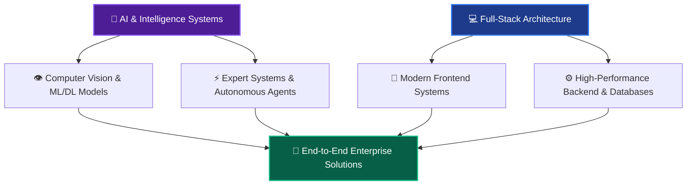
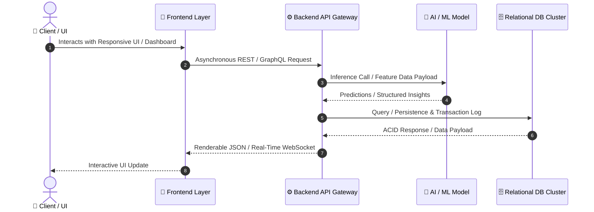

  <!-- Header Banner / GIF Animation -->
  

  <!-- Subtitle -->
  <h3>🎓 Information Technology Engineer | AI & Intelligence Systems Specialist</h3>

  

    <b>Designing Scalable Architectures • Building Deep Learning Systems • Crafting Full-Stack Ecosystems</b>
  

  <!-- Badges -->
  

    
    
    
  

---

## 🌌 01. About Me & Engineering Vision

> **"Bridging the gap between Complex Theoretical Artificial Intelligence and Robust Engineering Implementations."**

* 🎓 **Academic Background:** Studying **Information Technology Engineering** with a specialization in **Artificial Intelligence**.
* 🔭 **Current Focus:** Engineering intelligent multi-agent workflows, deep neural architectures, and scalable end-to-end cloud platforms.
* ⚡ **Core Philosophy:** Clean Code, SOLID Principles, Model Optimization, and High-Availability Database Design.

---

## 🧠 02. Artificial Intelligence & Data Science Mastery

---

## 💻 03. Full-Stack & Database Engineering Architecture

### 🛠️ Technology Stack Breakdown

#### 🔍 Deep Dive into Full-Stack & Database Engineering

* **Frontend Development (تفاصيل الواجهات):** تصميم وتطوير واجهات مستخدم متجاوبة (Responsive UI)، Single Page Applications، بناء تطبيقات الموبايل متعددة المنصات باستخدام Flutter، إدارة الحالة البرمجية (State Management)، وهندسة مكونات برمجية قابلة لإعادة الاستخدام مع مراعاة تجربة المستخدم (UI/UX).
* **Backend Development (تفاصيل السيرفرات):** بناء واجهات برمجة تطبيقات قوية وسريعة باستخدام FastAPI و Laravel، هندسة الأنظمة الموزعة، إدارة العمليات غير المتزامنة (Asynchronous Processing)، التوثيق والأمان (JWT/OAuth)، وإدارة وتطوير خدمات الـ Microservices.
* **Database Management (تفاصيل إدارة القواعد):** تصميم قواعد البيانات المتقدمة باستخدام EER Modeling، كتابة واستحداث Stored Procedures و Triggers و PL/SQL Scripting (Oracle 12c)، تحسين أداء الاستعلامات المعقدة (Query Optimization)، وضع استراتيجيات الفهرسة (Indexing)، وتطبيق مستويات التسوية (Normalization من 1NF حتى BCNF).

---

## 🛠️ 04. DevOps, Tooling & System Administration

| Category | Specialized Tools & Environments |
| --- | --- |
| **Version Control & CI/CD** | `Git`, `GitHub Actions`, `GitLab`, `Repository Management` |
| **System Administration** | `Linux (Ubuntu/Debian)`, `Windows PowerShell`, `Bash Scripting` |
| **Dev Environments** | `VS Code`, `Cursor IDE`, `MSYS2 UCRT64`, `Docker` |
| **API & Architecture** | `Postman`, `Mermaid.js`, `UML Modeling (Use Case, Activity, Sequence)` |

---
## 📈 05. GitHub Live Analytics & Performance Metrics

  <!-- إحصائيات الحساب واللغات الأكثر استخداماً -->
  <table border="0">
    <tr>
      <td width="50%">
        
      </td>
      <td width="50%">
        
      </td>
    </tr>
  </table>

   

  <!-- بطاقة استمرارية العمل والتفاعل Daily Streak -->
  

---

## 🤝 06. Let's Connect & Collaborate

  
I am open to research collaborations, AI software development projects, and innovative technical roles.

  <!-- أزرار التواصل -->
  
  
  

    
  
  <!-- Banner الختام البصري -->
  

