

<!-- Animated Header Banner -->

<!-- Robots + Typing Animation -->
<table border="0">
  <tr>
    <td align="center" width="25%"></td>
    <td align="center" width="50%">
      
    </td>
    <td align="center" width="25%"></td>
  </tr>
</table>

<h3>🎓 Information Technology Engineers | AI &amp; Intelligence Systems Specialists</h3>

  <b>Designing Scalable Architectures • Building Deep Learning Systems • Crafting Full-Stack Ecosystems</b>

<!-- Badges -->

  
  
  
  

## 👥 00. Meet The Team

| 👨‍💻 **Nibras Daboul** | 👩‍💻 **Dana Hajjar** |
| :---: | :---: |
| Information Technology Engineer | Information Technology Engineer |
| AI & Intelligence Systems & Experta Systems | AI & Intelligence Systems & Ritrival Systems |
| Deep Learning • Backend • Databases | Full-Stack • Frontend • Data Science |

## 🌌 01. About Us & Engineering Vision

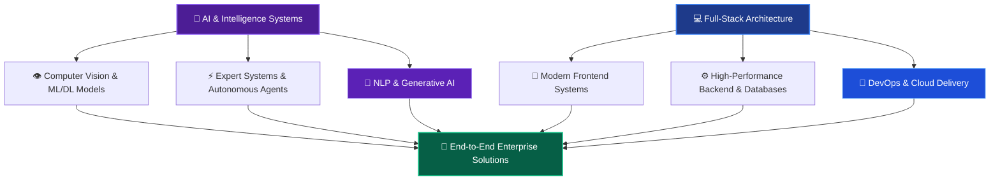

> **"Bridging the gap between Complex Theoretical Artificial Intelligence and Robust Engineering Implementations."**

* 🎓 **Academic Background:** Studying **Information Technology Engineering** with a specialization in **Artificial Intelligence**.
* 🔭 **Current Focus:** Engineering intelligent multi-agent workflows, deep neural architectures, and scalable end-to-end cloud platforms.
* ⚡ **Core Philosophy:** Clean Code, SOLID Principles, Model Optimization, and High-Availability Database Design.

### 🧭 Skills Mind Map

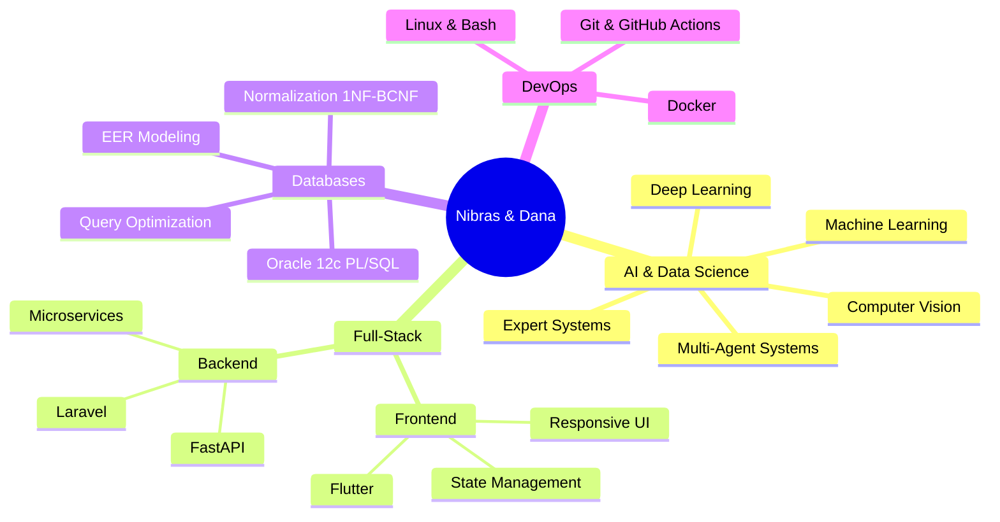

## 🧠 02. Artificial Intelligence & Data Science Mastery

  
   <i>Animated feed-forward neural network — signals flowing from input to output</i>

### 🔄 Machine Learning Lifecycle

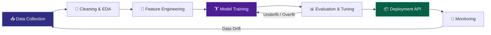

### 🤖 Multi-Agent Workflow

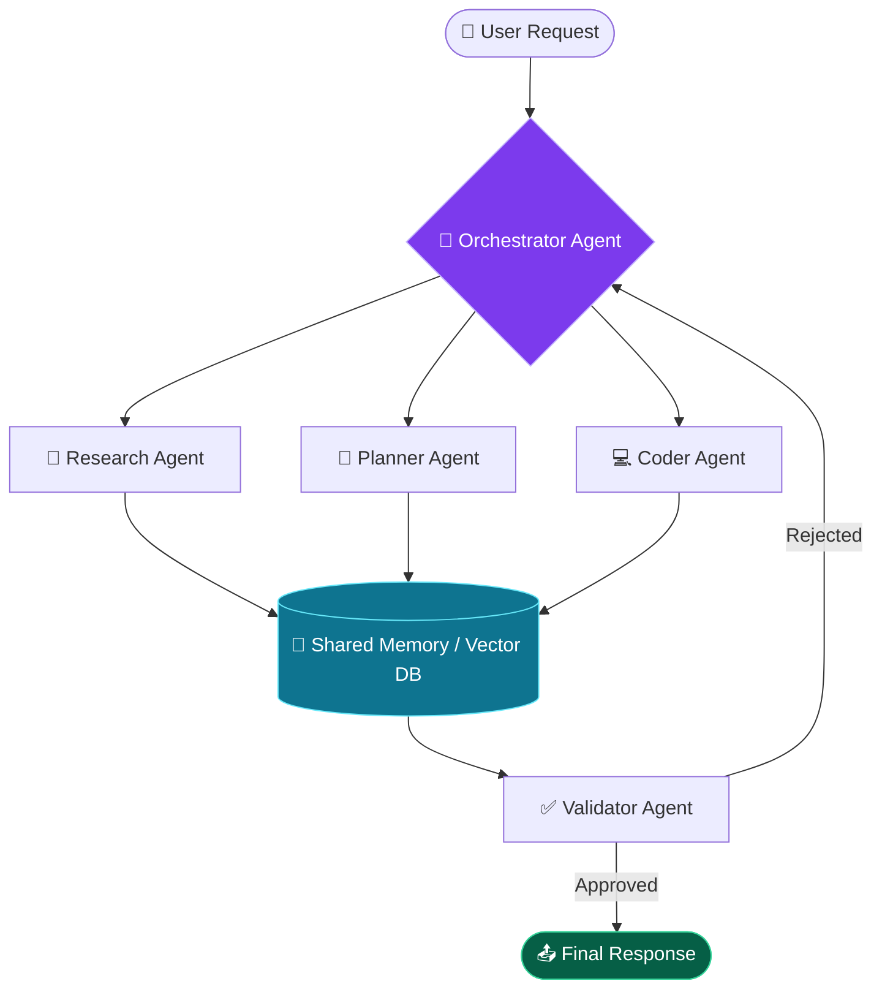

### 📊 Expertise Distribution

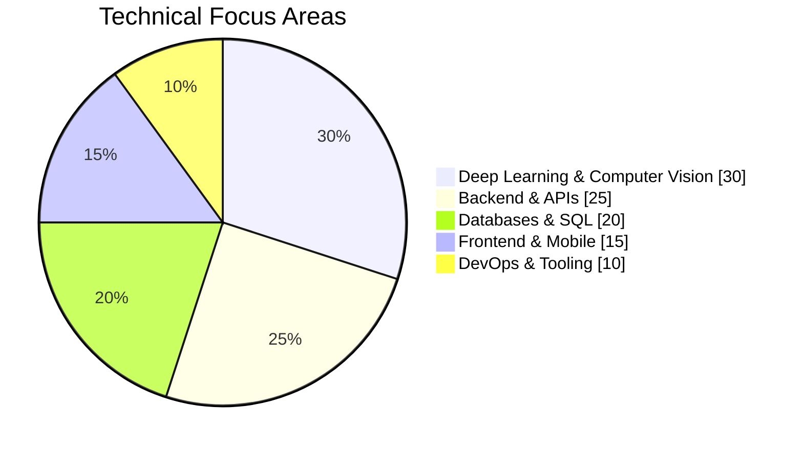

### 📈 Proficiency Overview

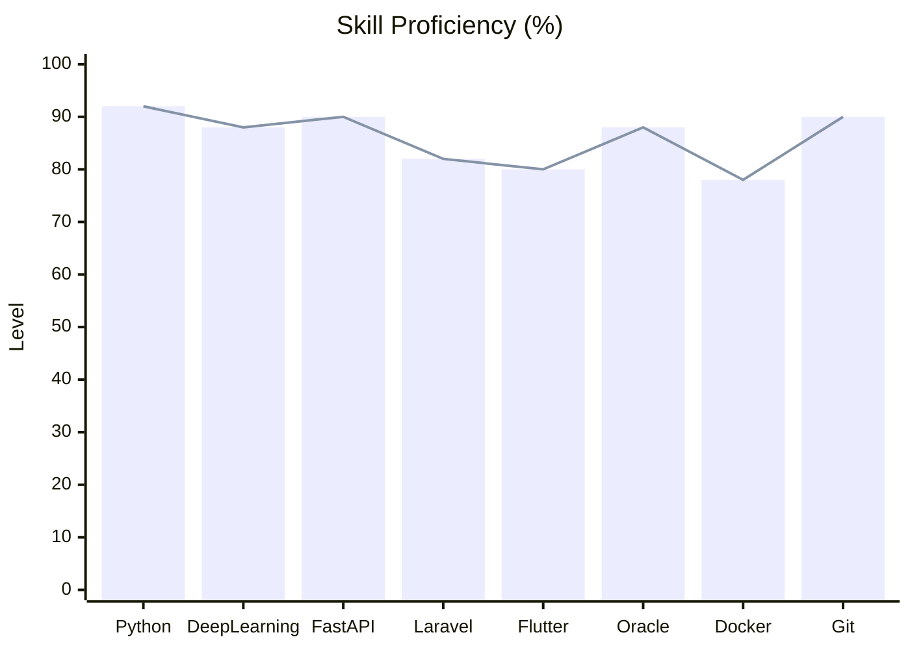

## 💻 03. Full-Stack & Database Engineering Architecture

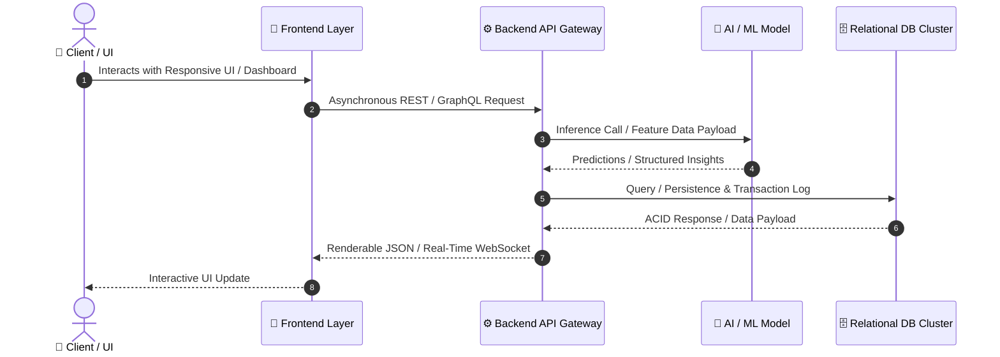

### 🏗️ System Architecture Overview

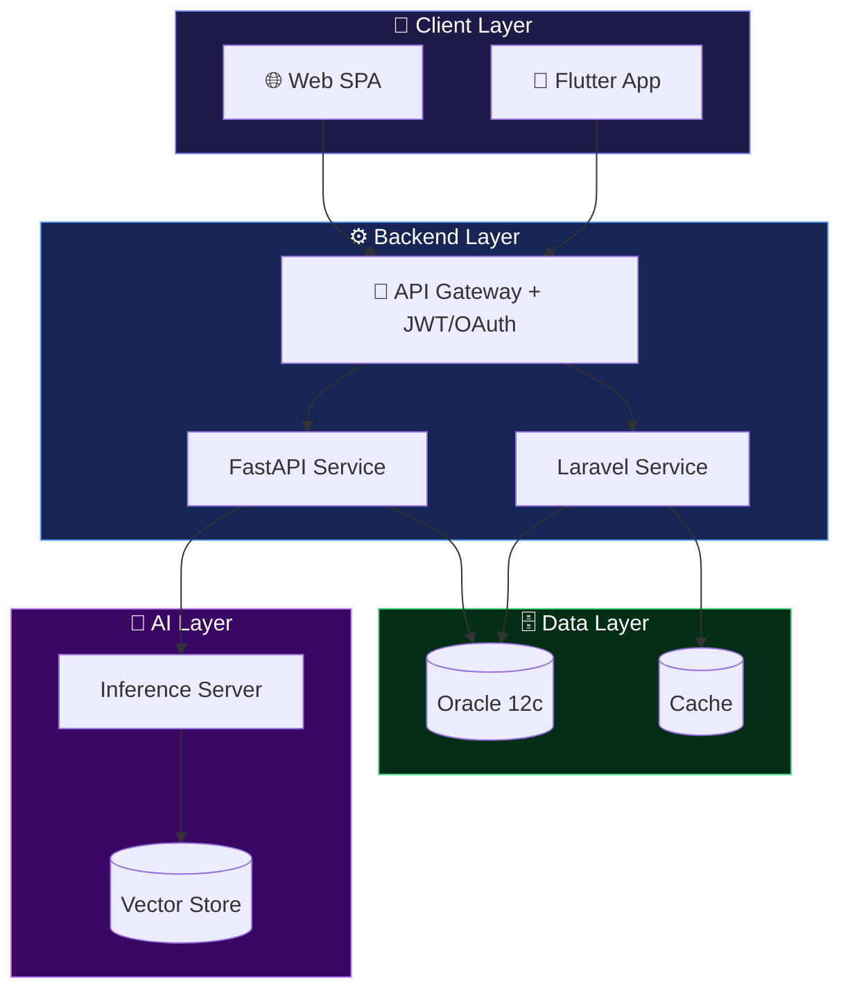

### 🗃️ Sample EER / Database Model

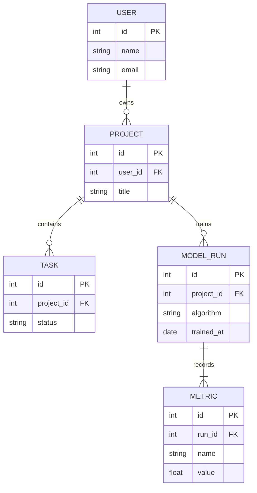

### 🔐 Authentication State Machine

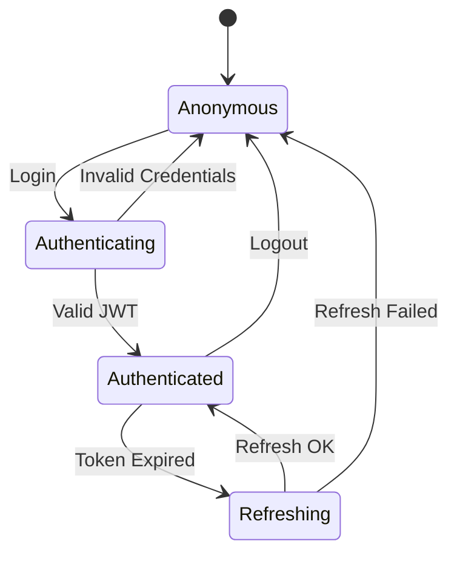

### 🛠️ Technology Stack Breakdown

#### 🔍 Deep Dive into Full-Stack & Database Engineering

* **Frontend Development (تفاصيل الواجهات):** تصميم وتطوير واجهات مستخدم متجاوبة (Responsive UI)، Single Page Applications، بناء تطبيقات الموبايل متعددة المنصات باستخدام Flutter، إدارة الحالة البرمجية (State Management)، وهندسة مكونات برمجية قابلة لإعادة الاستخدام مع مراعاة تجربة المستخدم (UI/UX).
* **Backend Development (تفاصيل السيرفرات):** بناء واجهات برمجة تطبيقات قوية وسريعة باستخدام FastAPI و Laravel، هندسة الأنظمة الموزعة، إدارة العمليات غير المتزامنة (Asynchronous Processing)، التوثيق والأمان (JWT/OAuth)، وإدارة وتطوير خدمات الـ Microservices.
* **Database Management (تفاصيل إدارة القواعد):** تصميم قواعد البيانات المتقدمة باستخدام EER Modeling، كتابة واستحداث Stored Procedures و Triggers و PL/SQL Scripting (Oracle 12c)، تحسين أداء الاستعلامات المعقدة (Query Optimization)، وضع استراتيجيات الفهرسة (Indexing)، وتطبيق مستويات التسوية (Normalization من 1NF حتى BCNF).

## 🛠️ 04. DevOps, Tooling & System Administration

| Category | Specialized Tools & Environments |
| --- | --- |
| **Version Control & CI/CD** | `Git`, `GitHub Actions`, `GitLab`, `Repository Management` |
| **System Administration** | `Linux (Ubuntu/Debian)`, `Windows PowerShell`, `Bash Scripting` |
| **Dev Environments** | `VS Code`, `Cursor IDE`, `MSYS2 UCRT64`, `Docker` |
| **API & Architecture** | `Postman`, `Mermaid.js`, `UML Modeling (Use Case, Activity, Sequence)` |

### 🔁 CI/CD Pipeline

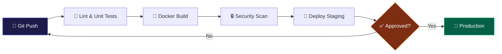

### 🌿 Git Branching Strategy

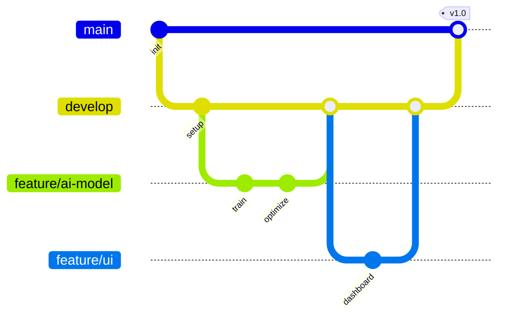

### 🗓️ Roadmap

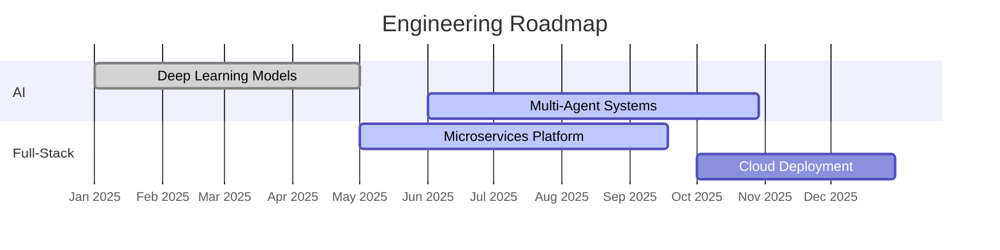

## 📈 05. GitHub Live Analytics & Performance Metrics

  <!-- Account stats & top languages -->
  <table border="0">
    <tr>
      <td width="50%">
        
      </td>
      <td width="50%">
        
      </td>
    </tr>
  </table>

   

  <!-- Daily Streak -->
  

    

  <!-- Trophies -->
  

    

  <!-- Contribution Activity Graph -->
  

    

  <!-- Dana's Stats: replace DANA_USERNAME with her GitHub username, then uncomment -->
  <!--
  
  -->

## 🤝 06. Let's Connect & Collaborate

  
We are open to research collaborations, AI software development projects, and innovative technical roles.

  

    

  <!-- Contact Buttons -->
  
  
  

    

  <i>✨ Designed & Engineered by <b>Nibras Daboul</b> &amp; <b>Dana Hajjar</b> ✨</i>

    

  <!-- Closing Banner -->
  

